<div align="center">


<br/>


<br/><br/>

[](https://github.com/benni-os/benni-inference-engine/actions/workflows/ci.yml)
[](#-benchmarks-rtx-4060-8gb--ryzen-5-5600x--32gb-ram)
[](https://www.python.org/)
[](https://developer.nvidia.com/cuda-toolkit)
[](https://github.com/ggml-org/llama.cpp)
[](LICENSE)
[](https://github.com/benni-os)

<br/>

> **"Frontier MoE models on consumer hardware. Every token at the ceiling."**


<br/>



<br/>

</div>

<br/>

## ⭐ What Is benni-inference-engine?

**benni-inference-engine** (`BIE`) is the sovereign local inference runtime of the **[Benni OS](https://github.com/benni-os)** ecosystem — a GPU+CPU hybrid engine that runs frontier Mixture-of-Experts models on consumer hardware, with **Skill 81 Ceiling Extraction**, **Quantized KV Cache**, **Speculative Decoding**, and **Project Benjamin Native MCP** built into every inference call.

Every other inference runtime treats the model as a black box. `BIE` treats the model as a cognitive system to be engineered — injecting the right prompt architecture, context compression, behavioral profile, and cyber-security guardrails automatically.

```
Project Benjamin / Antigravity / Claude / OpenAI SDK
         ↓ POST /v1/chat/completions  (OpenAI-compatible) or Native MCP stdio
    ┌──────────────────────────────────────────────────────────────┐
    │                    benni-inference-engine                    │
    │                                                              │
    │  ┌──────────────┐  ┌──────────────┐  ┌────────────────────┐  │
    │  │ Skill 81     │  │ Speculative  │  │ MoE Scheduler      │  │
    │  │ Ceiling      │→ │ Decoding &   │→ │ GPU: attention     │  │
    │  │ Extraction   │  │ Grammar Guard│  │ CPU: FFN experts   │  │
    │  └──────────────┘  └──────────────┘  └────────────────────┘  │
    │  ┌──────────────┐  ┌──────────────┐  ┌────────────────────┐  │
    │  │ Injection    │  │ Quantized KV │  │ Adaptive Hot-Pin   │  │
    │  │ Firewall     │  │ (q4_0 / q8_0)│  │ Memory Tracker     │  │
    │  └──────────────┘  └──────────────┘  └────────────────────┘  │
    └──────────────────────────────────────────────────────────────┘
         ↓                                ↓
    RTX 4060 (8 GB)              Ryzen + 32 GB RAM
    ~30 tok/s (Attention + KQV)  MoE expert cache + Paged KV
```

<br/>


## ⚡ Core Architecture & Doctrine

> These are not optional settings. These are architecture laws.

| ☔ Feature / Law | 🔧 Implementation | Impact |
|---|---|---|
| **Dual-Model Sovereign Engine** | Default primary Coder (`Cyber-Tiel-Coder-35B`) + secondary Vision (`Gemma-4-26B`) | Unified code mastery and multimodal vision intelligence |
| **Autonomous Dual Orchestrator** | Automatic request dispatch based on modal inspection (`dual_model.py`) | Zero manual configuration for text vs image queries |
| **Multimodal Vision Engine** | OpenAI vision parser, base64/local image ingest, token injection (`vision.py`) | Native visual understanding without cloud egress |
| **Cooperative VRAM Arbiter** | Dynamic layer allocation & cooperative split on 8GB GPU (`vram_arbiter.py`) | Concurrent execution of 35B and 26B without OOM |
| **GPU+CPU Hybrid MoE** | Attention + shared layers on VRAM; routed FFN experts on RAM (`moe_scheduler.py`) | 30B+ MoE viable on 8GB consumer GPUs |
| **Skill 81 Ceiling Extraction** | SA-81A Role Lock, SA-81B Causal Pruning, SA-81C Forced CoT, SA-81E Profiles | Eliminates behavioral capability ceiling gap |
| **Quantized KV Cache** | `q4_0`, `q4_1`, `q8_0`, `f16` dynamic allocation (`kv_quant.py`) | **>70% VRAM reduction** (1.7 GB vs 6.1 GB at 32k) |
| **Speculative Decoding** | Draft model generation + target parallel rejection verification (`speculative.py`) | Significant decode speedup in memory-bound setups |
| **Grammar Guard** | JSON Schema enforcement + auto-repair of malformed LLM outputs (`grammar_guard.py`) | 100% deterministic structured outputs |
| **Tool / Function Calling** | Full OpenAI function calling (`tools`, `tool_choice`, `message.tool_calls`) | Native multi-agent execution |
| **Cyber Sentinel Firewall** | Pre-inference prompt injection & jailbreak firewall (`injection_firewall.py`) | Tier-0 security against prompt extraction & spoofing |
| **Autonomous Reflection** | Multi-turn critique & temperature decay upon guard failure (`reflection_loop.py`) | Self-correcting generation loops |
| **Hybrid Task Router** | Routes DELTA/BRAVO/CHARLIE locally; cloud failover for huge context (`router.py`) | Zero token cost for code/research; sovereign privacy |
| **Continuous Batcher** | Multi-slot concurrent token multiplexer (`continuous_batcher.py`) | High concurrency without blocking incoming streams |
| **Paged Cache Allocator** | Non-contiguous virtual-to-physical block table paging (`paged_cache.py`) | Zero memory fragmentation |
| **Dynamic LoRA Manager** | Multi-adapter registration, activation, and scaling without reload (`lora_manager.py`) | Specialized domain tasks on base model |
| **Native MCP Server** | Fast JSON-RPC 2.0 stdio server (`mcp_bridge.py`) | Direct plug into Project Benjamin & IDE agents |
| **Real-Time Telemetry** | Latency percentiles (P50, P90, P99) + ASCII MoE expert heatmap (`telemetry.py`) | Instant operational visibility |

<br/>


## 🚀 Quick Start & CLI Reference

```bash
# Clone repository
git clone https://github.com/benni-os/benni-inference-engine
cd benni-inference-engine

# Install dependencies (CUDA 12.x recommended for GPU offload)
pip install -e ".[cuda]"

# 1. Download model from Hugging Face
bie pull qwen3-30b-a3b

# 2. Compute dynamic VRAM layer allocation between Coder-35B and Gemma-4
bie arbiter --mode cooperative_split

# 3. Serve OpenAI-compatible API (default: Cyber-Tiel-Coder-35B)
bie serve --port 8080
```

### Complete CLI Commands

```bash
# Serve model over HTTP with Uvicorn (default: Cyber-Tiel-Coder-35B)
bie serve --port 8080

# Benchmark single decode and prefill speed
bie bench --reps 3

# Calculate cooperative GPU layer split between Coder and Vision
bie arbiter --mode cooperative_split

# Run multimodal vision analysis with Gemma-4
bie vision --image diagram.png --prompt "Explain the data flow"

# Run automated multi-context benchmark matrix (1k, 4k, 8k)
bie matrix --contexts 1024 4096 8192

# Inspeciona hardware e metadados de GGUF com safe-streaming parser
bie inspect --model Cyber-Tiel-Coder-35B-A3B-MTP-UD-Q4_K_XL.gguf

# Audit text against hallucination, drift, and unanchored claims (SA-81D)
bie guard --prompt "What is BIE?" --output "[VERIFIED] BIE is Benni Inference Engine."

# Launch native MCP JSON-RPC 2.0 stdio server
bie mcp

# Download GGUF models directly from HuggingFace
bie pull unsloth/Qwen3-30B-A3B-Instruct-GGUF
```

<br/>


## 🌐 OpenAI API & Endpoints Reference

Any standard OpenAI SDK (Python, TypeScript, LangChain, AutoGen) works out of the box:

```python
from openai import OpenAI

client = OpenAI(base_url="http://localhost:8080/v1", api_key="bie")

# 1. Chat Completion with Skill 81 & Structured Schema (Default: Cyber-Tiel-Coder-35B)
response = client.chat.completions.create(
    model="Cyber-Tiel-Coder-35B-A3B-MTP-UD-Q4_K_XL.gguf",
    messages=[{"role": "user", "content": "Analyze system architecture and write zero-copy parser"}],
    extra_body={"task_type": "BRAVO", "apply_skill81": True, "guard": True}
)

# 2. Multimodal Vision Completion (Auto-routed to Gemma-4-26B)
vision_response = client.chat.completions.create(
    model="gemma-4-26B-A4B-it-UD-Q4_K_XL.gguf",
    messages=[
        {
            "role": "user",
            "content": [
                {"type": "text", "text": "Analyze this architecture diagram:"},
                {"type": "image_url", "image_url": {"url": "data:image/png;base64,iVBORw0KGgo..."}},
            ],
        }
    ],
)

# 3. Vector Embeddings
emb = client.embeddings.create(
    input="Mixture-of-Experts memory optimization"
)
print("Vector length:", len(emb.data[0].embedding))
```

### REST API Endpoints

- `POST /v1/chat/completions` — Streaming, function/tool calling (`tools`), multimodal vision (`image_url`), JSON Schema, Skill 81 injection.
- `POST /v1/completions` — Raw completion generation with usage token tracking.
- `POST /v1/embeddings` — Unit-normalized $L_2$ vector embeddings.
- `GET /v1/models` — List of active models (includes primary coder and secondary vision models).
- `GET /v1/bie/arbiter` — Dynamic GPU layer budgeting & cooperative split calculation.
- `GET /v1/bie/metrics` — Live VRAM usage, KV current tokens, and hot-pinned experts.
- `GET /v1/bie/telemetry` — Rolling P50/P90/P99 latency, tokens/s, and ASCII MoE heatmap.
- `GET /v1/bie/health/detailed` — Real-time RAM, VRAM, and GPU thermal/power diagnostics.
- `POST /v1/bie/guard` — Direct SA-81D hallucination and drift verification.

<br/>


## 🧠 Skill 81 — Ceiling Extraction

| Sub-Agent | Mission | Trigger |
|---|---|---|
| **SA-81A** Prompt Architect | Role Lock + Task Frame (`DELTA`, `CHARLIE`, `BRAVO`, `ALPHA`, `FOXTROT`) | Every call |
| **SA-81B** Context Engineer | Proximity-causal ordering, dead-weight removal, causal compression | Context > 4K tokens |
| **SA-81C** Reasoning Extractor | Forced CoT, hypothesis scaffolding for complex reasoning | Multi-step / math / code |
| **SA-81D** Hallucination Guard | Epistemic claim classification (`[VERIFIED]`, `[INFERENCE]`), drift scoring | Every call |
| **SA-81E** Model Profile Adapter | Calibration per model (`format_lock_strict`, temperature, top_p) | Model load |
| **SA-81F** Benchmark Loop | Density ≥ 0.8, Precision ≥ 0.9, Transferability = 1.0 | Benchmark |

<br/>


## 📦 Supported Models & Hardware Placement

| Model | Architecture | Role | Active Params | VRAM | RAM | Speed (RTX 4060) | Status |
|---|---|---|---|---|---|---|---|
| **Cyber-Tiel-Coder-35B** | MoE (qwen35moe, 41L) | 👑 **Default Primary Coder** | ~3.5B | ~5.8 GB | ~18 GB | **~28 tok/s** | 🟢 **Primary Default** |
| **Gemma-4-26B** | MoE (gemma4, 30L) | 👁️ **Default Secondary Vision** | ~4B | ~5.0 GB | ~15 GB | **~26 tok/s** | 🟢 **Vision Default** |
| **Qwen3-30B-A3B** | MoE (128 exp) | General Reasoning | ~3B | ~5.5 GB | ~17 GB | **~30 tok/s** | 🟢 Supported |
| **Kimi K2 Distill** | Dense | Reasoning | ~32B | ~7.0 GB | ~20 GB | ~15–20 tok/s | 🟡 Beta |
| **Qwen3-235B-A22B** | MoE (256 exp) | Frontier Scale | ~22B | ~6.0 GB | ~26 GB | ~4–6 tok/s | 🟡 Beta |
| **DeepSeek-V4** | MoE (256 exp) | Frontier Scale | ~37B | ~7.0 GB | ~28 GB | ~3–5 tok/s | 🔵 Roadmap |

<br/>


## 🗂️ Project Structure

```
benni-inference-engine/
├── bie/
│   ├── __init__.py
│   ├── cli.py                        # Legacy bridge CLI
│   ├── core/
│   │   ├── admission.py              # Priority concurrency queue & OOM guard
│   │   ├── backend.py                # Llama.cpp backend adapter
│   │   ├── chunker.py                # Semantic chunker & context compressor
│   │   ├── continuous_batcher.py     # Multi-slot continuous batching
│   │   ├── dual_model.py             # Dual-model autonomous orchestrator (Coder+Vision)
│   │   ├── embeddings.py             # Vector embeddings & cosine similarity
│   │   ├── engine.py                 # Core BIE facade with lifecycle, chat & vision
│   │   ├── grammar_guard.py          # JSON Schema enforcer & syntax repair
│   │   ├── hot_pin.py                # Adaptive expert pinning with EWMA decay
│   │   ├── kv_manager.py             # KV cache with SA-81B causal pruning
│   │   ├── kv_quant.py               # Quantized KV cache (q4_0, q8_0, f16)
│   │   ├── lora_manager.py           # Dynamic LoRA adapter scaling
│   │   ├── moe_scheduler.py          # Deterministic GPU/CPU offload planner
│   │   ├── paged_cache.py            # Non-contiguous virtual block table pager
│   │   ├── prompt_templates.py       # ChatML, Llama-3, DeepSeek, Alpaca templates
│   │   ├── reflection_loop.py        # Self-correction feedback critique loops
│   │   ├── router.py                 # Hybrid task router (local vs cloud + vision)
│   │   ├── scheduler_quant_aware.py  # Safe streaming GGUF metadata profiler
│   │   ├── speculative.py            # Speculative decoding rejection sampler
│   │   ├── stop_sequences.py         # Multi-token streaming stop sequence matcher
│   │   ├── vision.py                 # Multimodal Vision Engine (OpenAI format, b64/file)
│   │   └── vram_arbiter.py           # Cooperative VRAM layer arbiter (8GB GPU split)
│   ├── models/
│   │   ├── registry.json             # Supported models catalog (primary + vision default)
│   │   └── profiles/                 # SA-81E model parameters & offload configs
│   ├── serve/
│   │   ├── health_monitor.py         # Real-time VRAM, RAM, and thermal monitor
│   │   ├── llama_server_adapter.py   # HTTP adapter for native llama-server
│   │   ├── mcp_bridge.py             # Project Benjamin MCP JSON-RPC 2.0 server
│   │   ├── openai_compat.py          # OpenAI-compatible FastAPI endpoints (/chat, /arbiter)
│   │   ├── telemetry.py              # Latency percentiles & ASCII MoE heatmap
│   │   ├── tool_caller.py            # OpenAI Function/Tool Calling parser
│   │   └── __main__.py               # CLI entrypoint (bench, serve, vision, arbiter...)
│   ├── skill81/
│   │   ├── ceiling_extractor.py      # SA-81A/B/C/E Prompt Architecture
│   │   ├── hallucination_guard.py    # SA-81D Fact-claim & drift monitor
│   │   └── injection_firewall.py     # Skill 63 Cyber-Sentinel firewall
│   └── tools/
│       ├── bench_matrix.py           # Multi-context automated benchmark matrix
│       ├── hub_downloader.py         # HuggingFace GGUF sync & downloader
│       └── vram_profiler.py          # Offline/Live VRAM and PCIe profiler
├── tests/                            # 142 unit tests (100% passing)
├── pyproject.toml
├── LICENSE
├── ROADMAP.md
└── README.md
```

<br/>


## 📊 Benchmarks (RTX 4060 8GB + Ryzen 5 5600X + 32GB RAM)

| Model | Quant | Speed | VRAM Usada | RAM Usada | Janela Contexto |
|---|---|---|---|---|---|
| Qwen3-30B-A3B | Q4_K_XL | **~30 tok/s** | 5.5 GB | 17 GB | 32K (KV q4_0) |
| Cyber-Tiel-Coder-35B | Q4_K_XL | **~28 tok/s** | 5.8 GB | 18 GB | 32K (KV q4_0) |
| Qwen3-30B-A3B | Q5_K_M | ~25 tok/s | 6.2 GB | 19 GB | 32K (KV q4_0) |
| Qwen3-235B-A22B | Q2_K | ~5 tok/s | 6.0 GB | 26 GB | 16K (KV q4_0) |

<br/>

<br/>


## 🌐 The Benni OS Ecosystem

`benni-inference-engine` is part of the **Benni OS** decentralized agentic architecture. The ecosystem is organized into modular **Public Open-Source Infrastructure** and **Proprietary Core Autonomous Systems**:

### 🔓 Public Open-Source Infrastructure

| Layer / Domain | Repository | Maintainer | Description | Status |
|---|---|---|---|---|
| **Security & Defense** | [**`agent-cyber-sentinel`**](https://github.com/BenniAlencar/agent-cyber-sentinel) | `@BenniAlencar` | Tier-0 Zero-Trust runtime security shield, prompt injection firewall & secret redactor. | 🟢 Stable (Apache-2.0) |
| **Execution & State** | [**`agent-run-ledger`**](https://github.com/BenniAlencar/agent-run-ledger) | `@BenniAlencar` | Resumable multi-step execution state machine, anti-loop circuit breaker & crash recovery. | 🟢 Stable (Apache-2.0) |
| **Long-Term Memory** | [**`agent-memory-mesh`**](https://github.com/BenniAlencar/agent-memory-mesh) | `@BenniAlencar` | Sovereign bi-temporal knowledge graph & episodic memory with multi-tenant isolation. | 🟢 Stable (Apache-2.0) |
| **Zero-Trust Verification** | [**`reality-lock`**](https://github.com/BenniAlencar/reality-lock) | `@BenniAlencar` | Cryptographic execution verification & signed SHA-256 evidence ledgers for side-effects. | 🟢 Stable (Apache-2.0) |
| **MCP Tooling Matrix** | [**`mcp-forge`**](https://github.com/benni-os/mcp-forge) | `Benni-OS` | Rapid developer toolchain for building, validating, and publishing Model Context Protocol servers. | 🟢 Public OSS |
| **Local Hybrid Inference** | [**`benni-inference-engine`**](https://github.com/benni-os/benni-inference-engine) | `Benni-OS` | GPU+CPU MoE expert offloading runtime with Skill 81 Ceiling Extraction on consumer hardware. | 🟢 Public OSS |
| **Federated Execution** | [**`benni-operator-gateway`**](https://github.com/benni-os/benni-operator-gateway) | `Benni-OS` | Unified policy-governed operator gateway for dispatching actions across local and cloud environments. | 🟢 Public OSS |
| **Model Routing Hub** | [**`benni-nexus`**](https://github.com/benni-os/benni-nexus) | `Benni-OS` | Intelligent LLM model router optimizing for latency, cost, and task-specific reasoning ceilings. | 🟢 Public OSS |
| **Autonomous Community** | [**`community-autopilot`**](https://github.com/benni-os/community-autopilot) | `Benni-OS` | Autonomous event-driven community management, issue triage, and repository telemetry. | 🟢 Public OSS |

---

### 🔒 Proprietary Core & Autonomous Systems (Enterprise Benni OS)

The open-source stack serves as the decentralized foundation for the enterprise-grade Benni OS autonomous swarm kernel:

| System | Role & Scope | Architecture Doctrine | Access |
|---|---|---|---|
| **Benni Master OS** | Central operating system kernel v9.4 governing 43 canonical skills, runtime contracts, and swarm coordination. | `Universal Skills 00–100` | 🔒 Private Core |
| **Project Benjamin** | Sovereign autonomous execution orchestrator with typed handoff contracts and zero-human-in-the-loop loops. | `Skill 93 Autonomous Dispatch` | 🔒 Private Core |
| **Project Adam** | Agent synthesis, benchmark evaluation, and continuous recursive self-evolution engine. | `Skill 92 Self-Evolution` | 🔒 Private Core |
| **Benni Control Plane** | Distributed state persistence, atomic snapshot restore protocols, and multi-tenant ledger governance. | `Skill 90 Control Plane OS` | 🔒 Enterprise |
| **Benni Social Hub** | Multi-channel content authority distribution, attribution engine, and automated revenue funnels. | `Skill 52 & Skill 95 Revenue Loop` | 🔒 Enterprise |
| **Benni Canvas** | Autonomous UI engineering subsystem v14.0 delivering generative high-end motion and responsive dashboards. | `Skill 54 Open Design & Skill 56` | 🔒 Enterprise |
| **Benni Nemesis** | Federated integration gateway connecting cloud APIs, vector databases, and multi-cloud webhooks. | `Skill 97 Nemesis Gateway` | 🔒 Private Core |
| **Benni OS Genesis** | Structured prompt engineering compilation and generative knowledge distillation engine. | `Skill 70 Model Behavior` | 🔒 Private Core |

---

👉 **Explore & Connect with the Benni OS Ecosystem:**
* **Official Website**: [https://bennios.dev](https://bennios.dev)
* **Benni Operator Hub**: [https://hub.bennios.dev](https://hub.bennios.dev)
* **GitHub Organization**: [https://github.com/benni-os](https://github.com/benni-os)
* **Maintainer Profile**: [https://github.com/BenniAlencar](https://github.com/BenniAlencar)
* **Documentation & Blueprints**: [https://docs.bennios.dev](https://docs.bennios.dev)

<br/>


<div align="center">

**benni-inference-engine** — *GPU+CPU Hybrid Inference by [Benni OS](https://github.com/benni-os)*

`MOE_OFFLOAD` • `SKILL_81_NATIVE` • `SPECULATIVE_DECODING` • `OPENAI_COMPATIBLE` • `PROJECT_BENJAMIN_NATIVE` • `MIT_LICENSE`

Engineered by **Benni Alencar** and the Benni OS Core Engineering Group

</div>
