<div align="center">


<br/>

[](https://github.com/benni-os/benni-inference-engine/actions/workflows/ci.yml)
[](#-benchmarks--zero-ram-spill-vram-matrix)
[](https://www.python.org/)
[](https://developer.nvidia.com/cuda-toolkit)
[](#-openai-api-drop-in-compatibility)
[](LICENSE)
[](https://benni-os.net)

<br/>

> **High-Throughput Sovereign Inference Engineered for 8GB–16GB Consumer GPUs.**  
> Run 30B–35B Mixture-of-Experts models with 32K+ context, zero RAM spill, and full OpenAI API compatibility — locally on your own hardware.

<br/>



</div>

---

## ⚡ Why benni-inference-engine (BIE)?

Most local inference servers fall off a performance cliff on **8GB–16GB consumer GPUs**: either you cap context at ~8K tokens, or the KV cache spills across PCIe into system RAM and tanks throughput.

**`benni-inference-engine` (`BIE`)** solves this with deterministic hardware-aware scheduling:

- **Zero-RAM-Spill KV Quantization (`q4_0` / `q8_0`)** — Compresses the KV cache by up to **71.9%** (`1.73 GB` vs `6.14 GB` at 32K context), keeping 32K+ context windows 100% resident in 8GB VRAM.
- **GPU+CPU Hybrid MoE Offloading** — Keeps attention heads, shared layers, and hot-pinned experts in VRAM while streaming cold routed FFN experts from system RAM.
- **Cooperative VRAM Arbiter** — Dynamically splits GPU layers between a primary Coding model (`Cyber-Tiel-Coder-35B`) and a Vision model (`Gemma-4-26B`) without OOM.
- **Drop-In OpenAI & MCP Server** — Works out-of-the-box with the official OpenAI SDK, LangChain, AutoGen, and stdio JSON-RPC 2.0 MCP clients.
- **Built-In Hardware Doctor (`bie doctor`)** — Probes your GPU, calculates exact zero-RAM-spill context ceilings, and recommends optimal KV quantization before you load a single weight.

---

## 🏗️ Architecture

```text
  OpenAI SDK / LangChain / IDE Agents / MCP Clients
         │
         ├──► HTTP  POST /v1/chat/completions, /v1/completions, /v1/embeddings
         └──► STDIO JSON-RPC 2.0 (bie mcp)
                       │
                       ▼
  ┌─────────────────────────────────────────────────────────────────────┐
  │                     benni-inference-engine (BIE)                    │
  │                                                                     │
  │  ┌───────────────────┐  ┌───────────────────┐  ┌─────────────────┐  │
  │  │ Admission & Guard │  │  Quantized KV     │  │  MoE Hybrid     │  │
  │  │ • Injection Shield│─►│  • f16 / q8_0     │─►│  • Attention/KV │  │
  │  │ • Grammar Guard   │  │  • q4_1 / q4_0    │  │    pinned VRAM  │  │
  │  │ • Tool Calling    │  │  • Paged Blocks   │  │  • Cold Experts │  │
  │  └───────────────────┘  └───────────────────┘  │    on Host RAM  │  │
  │                                                └─────────────────┘  │
  │  ┌───────────────────┐  ┌───────────────────┐  ┌─────────────────┐  │
  │  │ Cooperative VRAM  │  │  Speculative      │  │  Live Telemetry │  │
  │  │ Arbiter (Coder +  │  │  Decoding &       │  │  & bie doctor   │  │
  │  │ Vision Split)     │  │  Continuous Batch │  │  P50/P90/P99    │  │
  │  └───────────────────┘  └───────────────────┘  └─────────────────┘  │
  └─────────────────────────────────────────────────────────────────────┘
         │                                         │
         ▼                                         ▼
   Consumer GPU (8GB–16GB VRAM)             System RAM (16GB–32GB+)
   Attention + KQV + Hot Experts            Routed MoE FFN Experts
```

---

## 🚀 60-Second Quickstart

```bash
# 1. Clone and install (CUDA 12.x recommended for GPU offload)
git clone https://github.com/benni-os/benni-inference-engine
cd benni-inference-engine
pip install -e ".[cuda]"

# 2. Probe your GPU VRAM and compute zero-RAM-spill context limits
bie doctor

# 3. Run the 8GB–16GB zero-RAM-spill memory math benchmark
python scripts/benchmark_8gb_vram.py

# 4. Pull a model and start the OpenAI-compatible server
bie pull qwen3-30b-a3b
bie serve --port 8080

# 5. Test with the drop-in OpenAI SDK example
python examples/quickstart_openai_dropin.py
```

### Key CLI Commands

```bash
bie doctor                                   # Probe GPU VRAM, RAM & max zero-spill context
bie-probe --vram-gb 8 --json                 # Standalone probe with simulated VRAM & JSON output
bie serve --port 8080                        # Start OpenAI-compatible FastAPI + Uvicorn server
bie arbiter --mode cooperative_split         # Compute Coder + Vision GPU layer split
bie bench --reps 3                           # Run decode/prefill/VRAM throughput benchmark
bie matrix --contexts 1024 4096 8192         # Multi-context automated benchmark matrix
bie inspect --model Cyber-Tiel-Coder-35B.gguf# Inspect GGUF metadata & offload plan
bie pull unsloth/Qwen3-30B-A3B-Instruct-GGUF # Download GGUF weights from HuggingFace
bie mcp                                      # Launch native MCP JSON-RPC 2.0 stdio server
```

---

## 📊 Benchmarks & Zero-RAM-Spill VRAM Matrix

### KV-Cache Footprint Comparison (48 Layers, 8 KV-Heads, 128 Head-Dim)

| KV-Cache Quant | Bytes / Token | 8K Context | 16K Context | 32K Context | VRAM Savings vs FP16 |
|---|---:|---:|---:|---:|---:|
| **FP16** (`f16`) | 196,608 B | 1,536 MB | 3,072 MB | 6,144 MB | Baseline (0.0%) |
| **FP8 / INT8** (`q8_0`) | 104,448 B | 816 MB | 1,632 MB | 3,264 MB | **46.9%** |
| **INT4+** (`q4_1`) | 61,440 B | 480 MB | 960 MB | 1,920 MB | **68.8%** |
| **INT4** (`q4_0`) | 55,296 B | **432 MB** | **864 MB** | **1,728 MB** | **71.9%** |

### Max Context Without RAM Spill (5.5 GB Model Weights + 0.8 GB OS/CUDA Reserve)

| Consumer GPU Tier | Available KV Budget | FP16 Max Context | BIE `q8_0` Max Context | BIE `q4_0` Max Context | 32K Context Status (`q4_0`) |
|---|---:|---:|---:|---:|---|
| **8 GB** (e.g. RTX 4060) | 1.70 GB | 9,284 tokens | 17,476 tokens | **33,010 tokens** | 🟢 **Zero RAM Spill** |
| **12 GB** (e.g. RTX 3060 / 4070) | 5.70 GB | 31,129 tokens | 58,596 tokens | **110,683 tokens** | 🟢 **Zero RAM Spill** |
| **16 GB** (e.g. RTX 4060 Ti / 4080) | 9.70 GB | 52,974 tokens | 99,717 tokens | **188,355 tokens** | 🟢 **Zero RAM Spill** |

### Measured Hardware Throughput (RTX 4060 8GB + Ryzen 5 5600X + 32GB RAM)

| Model | Quant | Decode Speed | VRAM Used | Host RAM Used | Context Window |
|---|---|---:|---:|---:|---|
| **Qwen3-30B-A3B** | `Q4_K_XL` | **~30 tok/s** | 5.5 GB | 17 GB | 32K (`q4_0` KV) |
| **Cyber-Tiel-Coder-35B** | `Q4_K_XL` | **~28 tok/s** | 5.8 GB | 18 GB | 32K (`q4_0` KV) |
| **Gemma-4-26B (Vision)** | `Q4_K_XL` | **~26 tok/s** | 5.0 GB | 15 GB | 32K (`q4_0` KV) |
| **Qwen3-235B-A22B** | `Q2_K` | ~5 tok/s | 6.0 GB | 26 GB | 16K (`q4_0` KV) |

---

## 🌐 OpenAI API Drop-In Compatibility

Point any OpenAI SDK (Python, TypeScript, LangChain, AutoGen, Cursor, Continue) to `http://localhost:8080/v1`:

```python
from openai import OpenAI

client = OpenAI(base_url="http://localhost:8080/v1", api_key="bie")

# 1. Streaming Chat Completion
stream = client.chat.completions.create(
    model="Cyber-Tiel-Coder-35B-A3B-MTP-UD-Q4_K_XL.gguf",
    messages=[{"role": "user", "content": "Write a zero-copy ring buffer in Python."}],
    stream=True,
)
for chunk in stream:
    if chunk.choices and chunk.choices[0].delta.content:
        print(chunk.choices[0].delta.content, end="", flush=True)

# 2. Multimodal Vision Completion (auto-routed to Gemma-4-26B)
vision_response = client.chat.completions.create(
    model="gemma-4-26B-A4B-it-UD-Q4_K_XL.gguf",
    messages=[
        {
            "role": "user",
            "content": [
                {"type": "text", "text": "Explain this architecture diagram:"},
                {"type": "image_url", "image_url": {"url": "data:image/png;base64,..."}},
            ],
        }
    ],
)

# 3. L2-Normalized Vector Embeddings
emb = client.embeddings.create(input="Mixture-of-Experts memory optimization")
print("Dimensions:", len(emb.data[0].embedding))
```

### REST Endpoints

| Method | Endpoint | Purpose |
|---|---|---|
| `POST` | `/v1/chat/completions` | Streaming, tool/function calling, multimodal vision, JSON schema |
| `POST` | `/v1/completions` | Raw text completion with token usage accounting |
| `POST` | `/v1/embeddings` | $L_2$-normalized vector embeddings |
| `GET` | `/v1/models` | Active models (Coder + Vision) |
| `GET` | `/v1/bie/arbiter` | Dynamic GPU layer budgeting & cooperative split |
| `GET` | `/v1/bie/metrics` | Live VRAM usage, KV tokens, and hot-pinned experts |
| `GET` | `/v1/bie/telemetry` | Rolling P50/P90/P99 latency, tok/s, and MoE heatmap |
| `GET` | `/v1/bie/health/detailed` | Real-time RAM, VRAM, and GPU thermal/power diagnostics |

---

## 🗂️ Project Structure

```text
benni-inference-engine/
├── bie/
│   ├── cli.py                        # CLI bridge entrypoint
│   ├── core/
│   │   ├── admission.py              # Priority concurrency queue & OOM guard
│   │   ├── backend.py                # llama.cpp backend adapter
│   │   ├── continuous_batcher.py     # Multi-slot continuous batching
│   │   ├── dual_model.py             # Dual-model orchestrator (Coder + Vision)
│   │   ├── engine.py                 # Core BIE facade
│   │   ├── grammar_guard.py          # JSON Schema enforcer & syntax repair
│   │   ├── hot_pin.py                # Adaptive expert pinning with EWMA decay
│   │   ├── kv_manager.py             # KV cache manager
│   │   ├── kv_quant.py               # Quantized KV cache (q4_0, q4_1, q8_0, f16)
│   │   ├── moe_scheduler.py          # Deterministic GPU/CPU offload planner
│   │   ├── paged_cache.py            # Non-contiguous virtual block table pager
│   │   ├── scheduler_quant_aware.py  # Safe streaming GGUF metadata profiler
│   │   ├── speculative.py            # Speculative decoding rejection sampler
│   │   ├── vision.py                 # Multimodal Vision Engine
│   │   └── vram_arbiter.py           # Cooperative VRAM layer arbiter
│   ├── serve/
│   │   ├── health_monitor.py         # Real-time VRAM, RAM, and thermal monitor
│   │   ├── llama_server_adapter.py   # HTTP adapter for native llama-server
│   │   ├── mcp_bridge.py             # Native MCP JSON-RPC 2.0 stdio server
│   │   ├── openai_compat.py          # OpenAI-compatible FastAPI endpoints
│   │   ├── telemetry.py              # Latency percentiles & MoE heatmap
│   │   └── __main__.py               # CLI entrypoint (doctor, serve, bench, ...)
│   └── tools/
│       ├── bench_matrix.py           # Multi-context automated benchmark matrix
│       ├── doctor.py                 # Hardware diagnostics & VRAM probe (bie doctor)
│       ├── hub_downloader.py         # HuggingFace GGUF sync & downloader
│       └── vram_profiler.py          # Offline/Live VRAM and PCIe profiler
├── examples/
│   ├── quickstart_openai.py          # Minimal OpenAI SDK example
│   └── quickstart_openai_dropin.py   # Streaming + Tool Calling + Embeddings quickstart
├── scripts/
│   ├── benchmark_8gb_vram.py         # 8GB-16GB zero-RAM-spill KV compression benchmark
│   └── gate_30b_runner.py            # 30B MoE hardware gate runner
└── tests/                            # Full pytest suite
```

---

## 🌍 Part of the Benni OS Ecosystem

Built by **Benni Alencar** and the **Benni OS** engineering group.

- **Official Website**: [https://benni-os.net](https://benni-os.net)
- **GitHub Organization**: [https://github.com/benni-os](https://github.com/benni-os)
- **Maintainer**: [https://github.com/BenniAlencar](https://github.com/BenniAlencar)

<div align="center">


**benni-inference-engine** — *High-Throughput Sovereign Inference for Consumer GPUs* • [benni-os.net](https://benni-os.net) • `MIT License`

</div>
